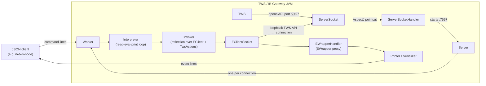

# Architecture

ib-tws-json gives the Interactive Brokers TWS API a line-based JSON protocol, so
any language that can open a TCP socket can use it without an official client
library. This document explains how it works and where to change it.

The project has three main design features:

1. **It runs inside the TWS (or IB Gateway) JVM.** It is installed as a
   `-javaagent`, so no separate process has to be started or kept alive.
2. **It finds the TWS API port by itself.** An AspectJ aspect watches TWS open
   its API `ServerSocket` and opens a JSON port next to it.
3. **The JSON API is generated, not hand-written.** Commands, events and the
   `help` schema are all built by reflection over the official Java client
   (`EClient`, `EWrapper`), so a new TWS API release usually needs few or no
   code changes.

## Overview



Each JSON client connection gets its own `Worker`, `Interpreter` and
`EClientSocket`. So each client opens its own TWS API connection, with its own
`clientId`, exactly as an official client would.

## Deployment modes

`Agent` is the `-javaagent` entry point (`Premain-Class` and `Agent-Class` in
the jar manifest). `Shell --install` adds it to TWS's `tws.vmoptions` (or
`ibgateway.vmoptions`), and `--uninstall` removes it.

| Mode | How it starts | How the TWS API port is found |
|------|---------------|-------------------------------|
| **Agent with AspectJ** (default) | `-javaagent:ib-tws-json.jar=…` in the vmoptions file | `Agent` loads the AspectJ load-time weaver, and `ServerSocketHandler` intercepts TWS's `ServerSocket`. The JSON port is the TWS port plus `json-api-port-offset` (default 100), so 7497 becomes 7597. |
| **Agent with a fixed port** | The agent arguments include `json-api-port` | AspectJ is not loaded. `Agent.startServer` listens on `json-api-port` and connects to `tws-api-port`. |
| **Standalone** | `java -jar ib-tws-json.jar --interactive --tws-api-port 7497` | Given on the command line. `Launcher` builds a class loader with `TwsApi.jar`, and `Shell` runs one `Interpreter` on stdin/stdout. Useful for exploring and debugging the API. |

`TwsApi.jar` is not bundled. The jar build excludes `com/ib/**`, so users get
the official client from IBKR directly. Both `Launcher` (standalone) and
`Agent` (in TWS) search for it when they start: `--tws-api-jar`,
`--tws-api-path`, then the usual install folders (`~/IBJts`, `C:\TWS API`,
`~/Jts`, `~/Downloads`, …), choosing the highest version number first.

### Agent arguments

The agent argument string is JSON-like: comma-separated `"key":value` pairs,
written by `Shell` and parsed by `Agent.parseAgentArg`:

```
-javaagent:/opt/ib-tws-json-2.1.0.jar="tws-api-jar":"/home/me/IBJts/source/javaclient/TwsApi.jar","json-api-port-offset":100
```

Settings for one TWS configuration directory (`--jts-config-dir`) go in a JSON
object keyed by that directory, so several TWS logins on one machine can each
have their own ports:

```
…="tws-api-jar":"…/TwsApi.jar","/home/me/Jts/live":{"tws-api-port":7496,"json-api-port":7596}
```

When TWS starts, `Agent` merges the object for the current `jtsConfigDir`
system property over the top-level settings.

### Why the Java version must match TWS

The extension runs inside TWS's JVM, so its classes must load on the JRE that
TWS bundles (currently Java 17), and the AspectJ weaver must support that JVM.
`build.gradle` sets a Java 17 toolchain for this reason. Check which JRE TWS is
running with `grep 'java version' ~/Jts/launcher.log`. When TWS moves to a new
JRE, update the toolchain, `gradle/gradle-daemon-jvm.properties` and AspectJ
together.

## Request lifecycle

### Commands (client → TWS)

1. **`LineReader` / `ParsedInput`** read one command: a name followed by
   whitespace-separated JSON values. A value that is not valid JSON is reported
   as `error "Expected JSON value"`.
2. **`Interpreter`** passes the name and values to the `Invoker`. If the line
   is missing primitive values, `MoreInputExpected` makes it read the next line
   as a continuation. `Prompter` shows `...` for that in interactive mode.
3. **`Invoker.resolve`** picks the method (see [Commands and overloads](#commands-and-overloads)),
   and **`Deserializer`** converts each JSON value to its Java parameter type
   using that type's `PropertyType`.
4. **`Invoker.invoke`** calls the method on the `EClientSocket`, or on
   `TwsSocketActions` for this project's own commands (`help`, `sleep`,
   `eConnect`, …).

Errors are sent back as `error` events, for example `error "bogus?"` for an
unknown command.

### Events (TWS → client)

1. `TwsSocketActions.eConnect` starts IB's `EReader` thread and a thread that
   empties its message queue, as IB's samples do.
2. IB's `EDecoder` calls the `EWrapper`, which is a dynamic proxy
   (**`EWrapperHandler`**) that forwards every callback to the `Printer`.
   Replies to this project's own commands go through a matching `TwsEvents`
   proxy (`TwsEventsHandler`).
3. **`Printer`** writes the method name and each argument, serialized by
   **`Serializer`**, separated by tabs. Output is synchronized, so lines from
   different threads never mix.

### Threads per client

`Server` has one accept thread for each JSON port. Each client connection then
has a `Worker` thread (reading commands) and, after `eConnect`, IB's `EReader`
thread and the queue-processing thread (writing events).

## Type mapping

`PropertyType` describes a Java type for `Serializer`, `Deserializer` and
`help`. IB's classes use `name()` getters and `name(value)` setters rather than
JavaBeans `getX`/`setX`, so a property is any no-argument getter that has a
matching one-argument setter. Read-only IB classes (`Bar`, `HistoricalTick`,
`WshEventData`, …) are listed in `PropertyType.GETTERS`, and `Deserializer`
builds them through their constructors.

| Java type | JSON written | JSON accepted |
|-----------|--------------|---------------|
| `int` | number | number, or a numeric string |
| `long`, `double`, `Decimal`, other numbers | **string** (keeps full precision for clients such as JavaScript) | number or string |
| `boolean` | `true` / `false` | `true` / `false` |
| `String` | string | string in double quotes, or `null`; a number or `true`/`false` is passed as its text. An unquoted word is rejected (`Expected JSON value`) |
| enum | name, e.g. `"GROUPS"` | name, or the enum's IB numeric code (see below) |
| IB object (`Contract`, `Order`, …) | object, leaving out fields that are null or still at their default | object; missing fields keep their defaults |
| `List`, arrays | array | array |
| Exception (in `error`) | its message | — |

**Enums and numbers.** IB's API often takes an `int` where an enum exists, for
example `requestFA(int)` next to `requestFA(FADataType)`. When an enum is given
a number, `Deserializer` matches it against the enum's own IB code (a public
`int id()`, `val()`, `value()` or `code()` method, such as `FADataType.id()`,
where GROUPS is 1 and ALIASES is 3). Only enums with no such method use the
ordinal (position). So a number means the same thing whichever overload
handles it.

## Commands and overloads

`Invoker` makes every public `void` method of `TwsActions` and of the
`EClient` into a command. Some rules:

- **This project's actions win.** If `TwsActions` defines a name (for example
  `eConnect(clientId, extraAuth)`), the `EClient` methods with that name are
  hidden.
- **All overloads are kept.** For each call, `Invoker.resolve`:
  1. prefers variants taking exactly the given number of arguments;
  2. otherwise, if a variant needs more primitive values, waits for more input;
  3. otherwise uses variants that work with the missing trailing arguments set
     to `null`;
  4. ranks what remains by how well each JSON value's type fits each parameter
     (exact match before conversion), and uses the first variant whose
     arguments deserialize.

  So `requestFA 1` uses `requestFA(int)`, and `requestFA "GROUPS"` uses
  `requestFA(FADataType)`.
- **`help` shows one variant per name.** The output format is fixed, so for an
  overloaded name `help` describes the variant with the most parameters,
  preferring enum parameters over `int` ones (an enum parameter accepts both
  forms). For an overloaded event it describes the variant with the most
  parameters.
- **`*ProtoBuf` methods are hidden** (`ProtoBuf.java`). IB's API now has a
  protobuf version of most methods and callbacks, taking one protobuf message
  object (a few appeared in 10.37, and about 80 each in `EClient` and
  `EWrapper` in 10.50). JSON can't build or describe those messages, and IB's decoder
  calls the regular callback after each protobuf one, so a JSON client would
  get a duplicate, empty event line. They are therefore not commands, not
  forwarded as events, and not listed by `help`. IB's normal methods already
  use protobuf on the wire by themselves when TWS supports it. The one feature
  that is only available in protobuf form, IB's config API (`reqConfigProtoBuf`,
  `updateConfigProtoBuf` and their responses), is not available over JSON.

## Class map

| Class | Role |
|-------|------|
| `Launcher` | `Main-Class`: finds `TwsApi.jar` and starts `Shell` in a class loader that includes it |
| `Shell` | Command line: install/uninstall into the vmoptions file, launch TWS, or run interactively |
| `Agent` | `-javaagent` entry point: adds `TwsApi.jar` to the class path, starts AspectJ or a fixed-port `Server` |
| `ServerSocketHandler` | AspectJ aspect: starts and stops a `Server` when TWS opens and closes its API port |
| `Server` | Listens on a JSON port and starts a `Worker` per connection |
| `Worker` | Runs one client connection's `Interpreter` on its own thread |
| `Interpreter` | Read-eval-print loop: reads commands, resolves and invokes them, reports errors |
| `LineReader`, `ParsedInput` | Split input into a command name and JSON values, across lines if needed |
| `MoreInputExpected`, `SyntaxError` | Signal an incomplete line and invalid input |
| `Prompter` | Interactive `>` and `...` prompts |
| `Invoker` | Builds the command table by reflection and picks an overload for each call |
| `TwsActions`, `TwsSocketActions` | This project's own commands (`eConnect`, `help`, `sleep`, `exit`, …), and the `EClientSocket` and `EReader` they manage |
| `TwsEvents`, `TwsEventsHandler` | Events replying to those commands (`help`, `helpEnd`, `serverVersion`, …) |
| `EWrapperHandler` | `EWrapper` proxy: forwards IB callbacks as event lines (skipping protobuf ones) |
| `Printer`, `Serializer` | Write tab-separated event lines; Java → JSON |
| `Deserializer` | JSON → Java, including IB's read-only classes and enum codes |
| `PropertyType` | Describes a Java type's properties for serialization, deserialization and `help` |
| `ProtoBuf` | Identifies the `*ProtoBuf` methods to hide |

## Testing

The tests check the JSON layer without a running TWS, using recorded calls.

| Test | What it checks |
|------|----------------|
| `TestClientCalls` | Replays the 206 commands in `client-calls.json` through the `Interpreter` and checks the client receives exactly the same call |
| `TestOrderCalls` | The same for the order-condition calls in `orders-calls.json` |
| `TestWrapperCalls` | Replays the callbacks in `wrapper-calls.json` (written by hand) and checks the event lines |
| `TestOverloads` | Overload resolution, enum codes and `help` for overloaded names, against the real `EClientSocket` |
| `TestProtoBufHidden` | Protobuf methods are not commands, events or `help` entries |
| `TestAgent` | Agent argument parsing |

`IClient` is a hand-written copy of `EClient`'s non-protobuf methods. The
replay tests use it as a fake client.

### Regenerating the fixtures

`client-calls.json` comes from IB's own Java sample (`samples/testbed/Testbed.java`).
`test/com/meerkattrading/tws/Testbed.java` holds IB's sample operations,
adapted to call an `IClient` proxy that records each call after a JSON round
trip. `test/samples/testbed/` holds IB's sample builders (`ContractSamples`,
`OrderSamples`, …), unchanged.

```sh
./gradlew generateClientCalls   # writes test/com/meerkattrading/tws/client-calls.json
./gradlew generateOrderCalls    # writes test/com/meerkattrading/tws/orders-calls.json
```

## Upgrading the TWS API

The build downloads IBKR's "stable" installer for the build machine's platform,
so a new IB release is picked up by a clean build. For each new release:

1. **Check the JRE.** Confirm the new TWS still runs Java 17 and that
   `TwsApi.jar` is Java 17 bytecode (class file version 61). See
   [Why the Java version must match TWS](#why-the-java-version-must-match-tws).
2. **Build.** `./gradlew clean build`. A compile error usually means IB
   removed or changed a method that `IClient` or `Testbed.java` uses.
3. **Update the samples.** Copy IB's new sample builders from
   `build/dependencies/twsapi/samples/Java/samples/testbed/` into
   `test/samples/testbed/`, and port changes in IB's `Testbed.java` into
   `test/com/meerkattrading/tws/Testbed.java`, leaving out protobuf
   operations. Keep this project's fix in `financialAdvisorOperations`, which
   passes `FADataType.id()` where IB's sample passes `.ordinal()` (the ordinal
   is no longer the TWS API code), and in `historicalDataRequests`, which uses
   a fixed end date where IB's sample uses the current time (so regenerating
   the fixtures gives the same output).
4. **Update `IClient`** to match `EClient`'s non-protobuf methods.
5. **Regenerate the fixtures** and review the diff. A generator failure such
   as `NoSuchMethodException: …<init>()` means a new read-only IB class: add
   its getters to `PropertyType.GETTERS` and a `jsonToX` constructor call in
   `Deserializer`, as for `WshEventData`.
6. **Check new overloads and enums.** `Invoker` handles new overloads by
   itself. A new enum with an IB code works automatically if the code method
   is named `id`, `val`, `value` or `code`.
